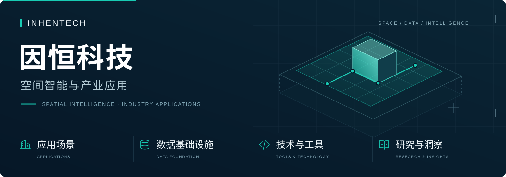

# 因恒科技 · 展示目录

从应用场景、数据基础设施、技术工具与研究洞察，了解因恒的探索方向。

> 栏目已建立，具体成果待补充。以下说明的是各栏目的内容范围，不表示相关成果已经发布。

<table>
<tr>
<td width="50%" valign="top">
<h3><a href="applications/README.md">应用场景 →</a></h3>

把空间与数据用在具体工作中。

<ul>
<li><a href="applications/buildings/README.md">建筑与资产管理</a></li>
<li><a href="applications/parks/README.md">园林与园区运营</a></li>
<li><a href="applications/tourism/README.md">文旅与村落体验</a></li>
<li><a href="applications/regional/README.md">区域协作与成果展示</a></li>
</ul>
</td>
<td width="50%" valign="top">
<h3><a href="data/README.md">数据基础设施 →</a></h3>

了解资料怎样被整理、关联和使用。

<ul>
<li><a href="data/spatial/README.md">建筑与空间资料</a></li>
<li><a href="data/industry/README.md">产业与市场数据</a></li>
<li><a href="data/evidence/README.md">项目资料与证据</a></li>
</ul>
</td>
</tr>
<tr>
<td width="50%" valign="top">
<h3><a href="tools/README.md">技术与工具 →</a></h3>

展示可在不同场景中复用的小工具与方法。

<ul>
<li><a href="tools/spatial-viewing/README.md">地图与三维浏览</a></li>
<li><a href="tools/content-routes/README.md">内容与路线组织</a></li>
<li><a href="tools/collaboration/README.md">项目协作与事项管理</a></li>
</ul>
</td>
<td width="50%" valign="top">
<h3><a href="research/README.md">研究与洞察 →</a></h3>

阅读技术方向、行业应用与产业分析。

<ul>
<li><a href="research/spatial-intelligence/README.md">空间智能研究</a></li>
<li><a href="research/industry-applications/README.md">行业应用研究</a></li>
<li><a href="research/market/README.md">产业与市场研究</a></li>
</ul>
</td>
</tr>
</table>

## 怎样浏览

选择一个栏目，再进入感兴趣的方向。每个成果位置将依次呈现：**这个成果做什么 · 效果预览 · 体验入口 · 相关资料**。

[返回 InhenTech 公司首页](https://github.com/InhenTech)
